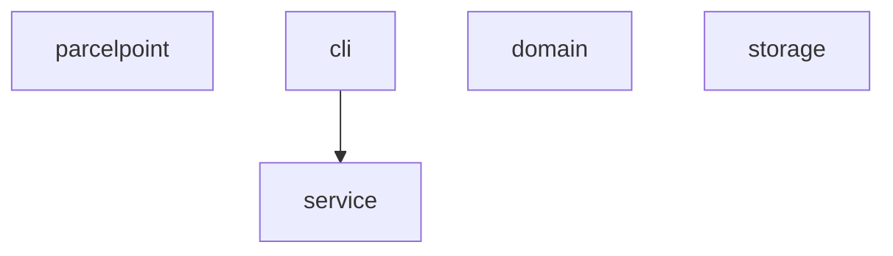
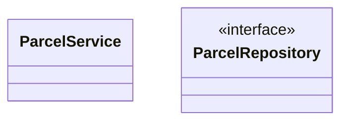
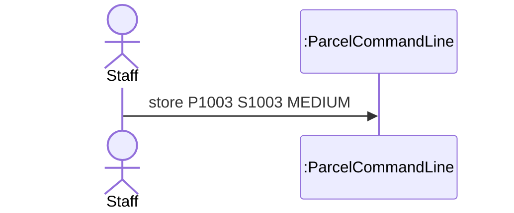

# Lab Report, Designing the Data Management Layer with H2

Repository URL:

## Tools

| Item | Version or name |
| --- | --- |
| JDK |openjdk version "25.0.4.1" 2026-08-18 LTS
OpenJDK Runtime Environment Temurin-25.0.4.1+1 (build 25.0.4.1+1-LTS)
OpenJDK 64-Bit Server VM Temurin-25.0.4.1+1 (build 25.0.4.1+1-LTS, mixed mode, sharing) |
| Maven | Apache Maven 3.10.0 (c43a36b8d67be7e0805a411bc0898af1a51f5472)
Maven home: C:\Tools\apache-maven-3.10.0-bin\apache-maven-3.10.0
Java version: 25.0.4.1, vendor: Eclipse Adoptium, runtime: C:\Program Files\Eclipse Adoptium\jdk-25.0.4.101-hotspot
Default locale: en_US, platform encoding: UTF-8, time zone: Asia/Bangkok
OS name: "windows 11", version: "10.0", arch: "amd64", family: "windows"|
| IDE |VS code |
| AI tool and exact model, if you used one | |

## Part 0. From a store in memory to H2

Commit of the starter, before any change:

0.3 Your prediction for `staff`, written before the second run: No. of Free locker is 3

Output of the second run, for `staff` and `quit`: 

```text
java -jar target/parcelpoint-h2-1.0.jar
ParcelPoint commands:
  store <code> <studentId> <SMALL|MEDIUM|LARGE>
  pickup <code> <days>
  find <code>
  staff
  quit
>staff
Free lockers: 3
>quit
```

State in one sentence where you think the parcels of the first run were kept.
>Keeping Data in the memmory as link hash map.

0.5 The line of Main that you would change to keep the parcels somewhere else:

```java
        ParcelRepository repository = new InMemoryParcelRepository(); // Old

        ParcelRepository repository = new H2ParcelRepository("./data/parcelpoint"); //new
```

0.6 Commit of the switch to H2:

0.7 Output of `SELECT * FROM PARCEL;` after you stored two parcels:

```text

```

0.8 Explain why ParcelPoint could not start while the H2 Shell was open, and identify the class that wrote the message `Cannot create the PARCEL table`.

0.9 Explain why `staff` shows no parcel while `find` shows each one, and why all three lockers look free.

0.11 Your findAll method:

```java

```

Commit that adds findAll:

0.12 Output of `SELECT * FROM PARCEL;` after the pickup:

```text

```

0.13 Optional. Describe what `find P9999'OR'1'='1` showed while the SQL was joined from strings, and what it showed after you put the placeholder back.

## Part A. Model the design

A1 Complete the flowchart with one node for each package and one arrow for each dependency, from the package that uses to the package that is used. Mark the package that accesses the data store.



State whether cli depends on storage, and explain why.

A2 Complete the class diagram of the data management layer with ParcelService, the interface ParcelRepository with its three operations, and the two classes that implement it.



A3 Draw a sequence diagram for the command `store P1003 S1003 MEDIUM`, from the staff member to the repository. Show each message as an operation of the class that receives it.



Explain why the last lifeline is the interface ParcelRepository rather than H2ParcelRepository.

## Part B. Design questions

1. Identify the files that you changed to move from the store in memory to H2, and explain why no other class had to change. Use the terms of this course.

2. The PARCEL table stores the size of a parcel as SMALL, MEDIUM or LARGE rather than as 1, 2 or 3. Identify the type of connascence between ParcelSize and the table in each case, and explain which one is weaker.

3. Project Phase 2 asks for a data store that needs no separate server. Explain why an embedded database such as H2 meets this rule, and describe the limit of an embedded database that Step 0.8 showed.

4. State the data store that you would choose for your Project Phase 2 team, files or an embedded database, the requirement that drives the choice, and the package that will access it.

## AI usage declaration

| AI tool and exact model | Date | Purpose | Files or answers it produced or changed | How you checked its output |
| --- | --- | --- | --- | --- |
| | | | | |
